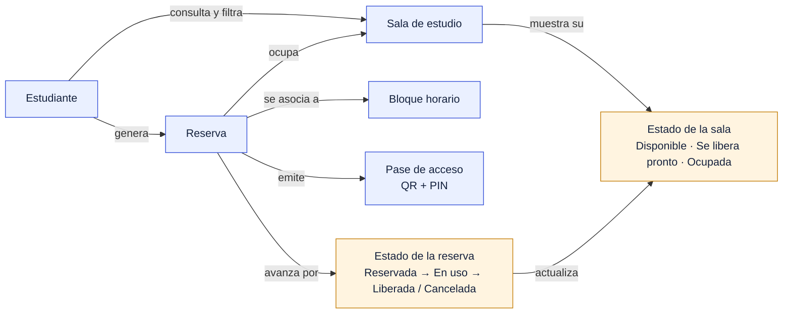

# 3. Modelo Conceptual

Un modelo conceptual describe a alto nivel cómo se organiza y opera un sistema, y qué conceptos necesita comprender el usuario para interactuar con él (Rogers et al., 2023). No corresponde al diseño visual final, sino a la lógica que permite construir una experiencia comprensible.

## 3.1 Qué hará el sistema y organización de la experiencia
El sistema funcionará como un **gestor visual de disponibilidad espacial y temporal en tiempo real** que conecta a los estudiantes con las salas de estudio de la universidad. La experiencia de interacción se organiza en tres momentos claros:
1. **Exploración y filtrado:** El estudiante visualiza el estado actual de todas las salas según campus, edificio y capacidad sin tener que navegar por menús profundos.
2. **Asignación directa:** El usuario selecciona una sala disponible, marca el bloque horario deseado y obtiene una confirmación instantánea.
3. **Validación y ciclo de uso:** Al llegar a la sala, el estudiante confirma su llegada (*check-in*) mediante un pase digital, y al retirarse puede liberar el espacio con un toque para actualizar la disponibilidad del sistema en tiempo real.

## 3.2 Conceptos principales que debe comprender el usuario
Para operar la plataforma sin ambigüedades, el modelo conceptual se estructura en seis conceptos fundamentales:
* **Estudiante (Usuario):** Persona que consulta las salas y es responsable de una reserva. Se identifica con su correo institucional.
* **Sala de Estudio (Recurso físico):** Espacio identificable por su código (ej. *Sala B-204*), ubicación (campus/edificio/piso), capacidad máxima de personas, equipamiento disponible (pizarra, pantalla HDMI, enchufes) y estado en tiempo real.
* **Bloque Horario (Unidad temporal):** Intervalo de tiempo de duración fija (90 minutos en el prototipo) asociado a una fecha y hora específica en el que una sala puede ser reservada.
* **Reserva (Compromiso de uso):** Registro activo que vincula a un estudiante responsable con una **Sala de Estudio** durante uno o más **Bloques Horarios** consecutivos.
* **Pase de Acceso (Credencial digital):** Comprobante generado automáticamente al confirmar una reserva (compuesto por un código QR y un PIN de 4 dígitos) que permite confirmar la llegada presencial dentro de los primeros 10 minutos del bloque.
* **Estado (Situación actual):** Indicador dinámico con dos niveles que no deben confundirse:
  * **Estado de la sala** (visible para toda la comunidad universitaria): *Disponible*, *Se libera pronto* u *Ocupada*.
  * **Estado de la reserva** (ciclo de vida de la reserva): *Reservada* → *En uso* → *Liberada*, o *Cancelada* si el estudiante desiste antes de usarla.

## 3.3 Relaciones entre los conceptos
Un **Estudiante** consulta el catálogo de **Salas de Estudio** filtrando por sus necesidades; al elegir una sala, inspecciona sus **Bloques Horarios** libres y genera una **Reserva**. Dicha **Reserva** bloquea temporalmente el espacio, cambia el **Estado de la sala** y emite un **Pase de Acceso**. Cuando el estudiante ejecuta *Confirmar llegada* o presiona *Liberar sala*, el **Estado de la reserva** avanza (*En uso* o *Liberada*) y el sistema actualiza el **Estado de la sala** para toda la comunidad universitaria.

*Figura 3.1. Relaciones entre los conceptos del modelo conceptual. Fuente: elaboración propia.*

| Concepto | Relación | Concepto | Cantidad |
| :--- | :--- | :--- | :---: |
| Estudiante | genera | Reserva | 1 a muchas |
| Reserva | ocupa | Sala de Estudio | muchas a 1 |
| Reserva | se asocia a | Bloque Horario | 1 a uno o más (consecutivos) |
| Reserva | emite | Pase de Acceso | 1 a 1 |
| Sala de Estudio | muestra | Estado de la sala | 1 a 1 |

## 3.4 Elementos del modelo conceptual
La siguiente tabla resume el modelo siguiendo la estructura propuesta por Rogers et al. (2023):

| Elemento del modelo | En la propuesta |
| :--- | :--- |
| **Conceptos principales** | Estudiante, sala de estudio, bloque horario, reserva, pase de acceso y estado. |
| **Objetos de interacción** | Filtros, ficha de sala, línea de bloques horarios, resumen de la reserva y pase de acceso (QR y PIN). |
| **Acciones posibles** | Filtrar, consultar el detalle de una sala, elegir un bloque, reservar, confirmar llegada, extender, liberar, cancelar, reportar un problema y deshacer. |
| **Relaciones entre conceptos** | Ver 3.3 y Figura 3.1. |
| **Experiencia que se busca apoyar** | Reservar una sala de forma rápida, clara y confiable, y poder extenderla o liberarla sin trabas. |

---

# 4. Metáfora de Interfaz

## 4.1 Metáfora seleccionada: Tablero de Fichas de Sala y Pase Digital
Una metáfora de interfaz permite que el usuario comprenda una función digital a partir de una experiencia que ya conoce (Rogers et al., 2023). La interfaz combina dos metáforas cotidianas del ámbito universitario: un **Tablero de Fichas** para la búsqueda y selección, y un **Pase o Ticket Digital** para la gestión de la reserva activa.

## 4.2 Justificación de la metáfora
* **Tablero de Fichas (Cards visuales):** Se apoya en las carteleras o paneles de horarios de salas que los estudiantes ven en los accesos de los edificios y de la biblioteca, donde cada sala aparece con su estado. Cada sala se presenta como una "ficha" individual que agrupa su nombre, capacidad, equipamiento mediante íconos y una franja de color semántico (verde para *Disponible*, ámbar para *Se libera pronto* y rojo para *Ocupada*). Esto permite escanear y comparar múltiples salas de un vistazo sin esfuerzo cognitivo.
* **Pase o Ticket Digital:** Una vez confirmada la selección, la reserva adopta la forma visual de un ticket o pase de acceso (similar a una tarjeta de embarque o entrada digital) que destaca la hora, el número de sala, el código QR y el PIN de acceso, junto con las acciones *Confirmar llegada* y *Liberar sala*. Esta metáfora comunica de forma intuitiva que el usuario posee un derecho temporal de uso que debe validar al llegar y devolver al salir.

## 4.3 Relación de la metáfora con la interfaz

| Elemento de la metáfora | Referente cotidiano | Aplicación en la interfaz |
| :--- | :--- | :--- |
| Ficha de sala | Fila o tarjeta de un panel de horarios | Tarjeta con nombre, ubicación, capacidad, equipamiento y estado. |
| Franja de color | Semáforo o indicador de estado | Franja verde, ámbar o roja, siempre acompañada de ícono y texto. |
| Bloque horario | Casilla de horario en una agenda | Botón seleccionable; el bloque ocupado aparece tachado. |
| Pase o ticket | Tarjeta de embarque o entrada | Pase con sala, horario, QR y PIN de acceso. |
| Mostrar la entrada al llegar | Validar la entrada en la puerta | *Confirmar llegada* dentro de los primeros 10 minutos. |
| Entregar la llave al terminar | Devolver la llave de la sala | *Liberar sala*. |

Según Rogers et al. (2023), una metáfora debe utilizarse solo mientras aporta a la comprensión. Por eso la interfaz mantiene el verbo cotidiano *Liberar* y no replica literalmente la entrega de una llave. Su pertinencia se comprobará con los usuarios en el plan de validación del apartado 8.7.

---

# 5. Tipos de Interacción

Los tipos de interacción (instruir, conversar, manipular, explorar y responder) describen las formas en que una persona interactúa con un producto (Rogers et al., 2023). La siguiente tabla relaciona cada tipo con las acciones concretas que ejecuta el estudiante dentro de la aplicación. **Cuatro de los cinco tipos están presentes en la propuesta; *conversar* no se incorpora**, por las razones indicadas en la última fila.

| Tipo de Interacción | Aplicación en el Sistema | Acciones concretas del usuario en la propuesta |
| :--- | :--- | :--- |
| **Instruir** | El usuario emite órdenes directas y explícitas al sistema mediante botones y filtros. | • Seleccionar campus, fecha y cantidad de personas en la barra de filtros. • Presionar **"Confirmar reserva"**, **"Confirmar llegada"** o **"Extender 30 min"**. • Ejecutar **"Liberar sala"**, **"Cancelar reserva"** o **"Reportar un problema"**. • Presionar **"Deshacer"** tras una acción. |
| **Manipular** | El usuario interactúa directamente con representaciones gráficas en pantalla mediante gestos táctiles. | • Deslizar horizontalmente la línea de bloques horarios. • Tocar directamente las fichas de salas y los bloques horarios para seleccionarlos. |
| **Explorar** | El usuario recorre un espacio digital acotado (el tablero de salas) para descubrir información y opciones sin comprometer una acción inmediata. En este caso no se trata de un entorno 3D, sino de un espacio de información organizado. | • Recorrer el tablero de salas y comparar su estado, ubicación y capacidad. • Abrir el detalle de una sala para revisar su equipamiento y bloques disponibles antes de decidir. |
| **Responder** | El sistema inicia la interacción mediante avisos y el usuario decide si reacciona. | • Recibir un recordatorio 10 minutos antes del inicio del bloque y confirmar la llegada dentro de los primeros 10 minutos. • Recibir un aviso 10 minutos antes del término del bloque y decidir entre extender o liberar la sala. |
| **Conversar** | **No aplica.** | La propuesta no incluye diálogo en texto ni en voz con el sistema. La alternativa conversacional (chatbot) se descartó en el apartado 2.3 porque exige varios turnos de pregunta y respuesta y dificulta comparar salas. Las acciones rápidas (por ejemplo, *Reportar un problema*) se resuelven con botones y corresponden al tipo *instruir*. |

Predominan *instruir* y *manipular*, adecuados a una tarea breve que se realiza de pie y con una mano, mientras que *responder* cubre el ciclo de uso de la reserva.

---

## Referencias

Rogers, Y., Sharp, H. & Preece, J. (2023). *Interaction design: Beyond human-computer interaction* (6.ª ed.). Wiley.
