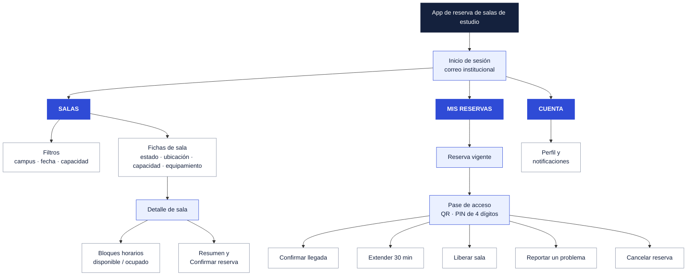
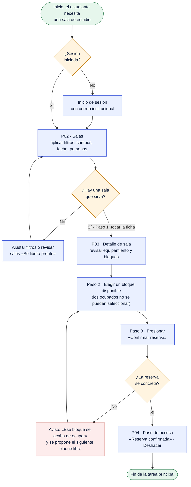
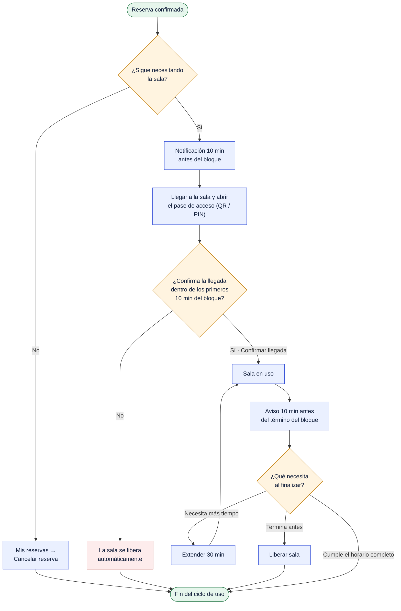

# 6. Arquitectura de Información y Flujo de Usuario

## 6.1 Propósito y enfoque

La arquitectura de información (AI) organiza los contenidos, categorías, etiquetas, rutas de navegación y sistemas de búsqueda de un entorno digital para que las personas puedan encontrar, comprender y utilizar la información que necesitan (Rosenfeld et al., 2015). En esta propuesta, la AI debe resolver un problema concreto: que un estudiante con poco tiempo entre clases encuentre una sala disponible y complete su reserva sin ambigüedades.

El flujo de usuario complementa a la AI: mientras la arquitectura define cómo se estructuran los contenidos, el flujo muestra cómo el estudiante recorre esa estructura para completar una tarea (Stimac, 2023). Ambos se diseñaron para apoyar la tarea principal definida en el apartado 1.4 (consultar la disponibilidad de una sala y reservar un bloque horario con confirmación inmediata) y para cumplir los requisitos RF01 a RF05 y RNF01 a RNF04.

Siguiendo los objetivos de la arquitectura de información descritos por Gabriel-Petit (2025), el equipo adoptó tres criterios de diseño:

* **Información fácil de encontrar:** el estado de cada sala es visible en la lista y puede acotarse con filtros.
* **Orientación permanente:** el usuario siempre sabe dónde está (pestaña activa, botón de retorno, indicador de actualización de datos) y qué puede hacer a continuación.
* **Baja sobrecarga de información:** la estructura tiene como máximo tres niveles de profundidad y cada pantalla destaca una sola acción principal.

---

## 6.2 Mapa de contenidos y componentes

### 6.2.1 Organización de las secciones

La aplicación se organiza en tres secciones principales, accesibles desde una barra de navegación inferior: **Salas**, **Mis reservas** y **Cuenta**.

*Figura 6.1. Mapa de contenidos de la aplicación. Fuente: elaboración propia.*

Decisiones de organización:

1. **Organización por tareas del usuario, no por estructura administrativa.** "Salas" responde a la pregunta *¿dónde puedo estudiar?* y "Mis reservas" responde a *¿qué tengo reservado y qué puedo hacer con ello?*. Esta separación reduce la confusión entre buscar una sala y gestionar una reserva ya hecha.
2. **Profundidad máxima de tres niveles.** El camino más largo de la tarea principal es Salas → Detalle de sala → Confirmar reserva, lo que apoya el requisito RNF01 (no más de 3 pasos).
3. **El pase de acceso vive en "Mis reservas".** Al confirmar una reserva, el sistema lleva al estudiante a esa sección, de modo que su comprobante siempre se encuentra en el mismo lugar.
4. **Las acciones sobre la reserva se agrupan en el pase.** Confirmar llegada, extender, liberar, reportar un problema y cancelar se concentran en una única vista, tal como lo exige RF05.

### 6.2.2 Componentes de la arquitectura de información

| Componente | Decisión en la propuesta |
| :--- | :--- |
| **Sistema de organización** | Jerárquico por ubicación (campus → edificio → piso → sala) y cronológico para los bloques horarios del día. El estado de la sala se muestra como atributo visible en cada ficha, no como una categoría separada. |
| **Sistema de etiquetado** | Vocabulario cotidiano y consistente en toda la interfaz, regido por cuatro reglas (ver 6.3). |
| **Sistema de navegación** | Global (barra inferior con tres destinos), local (botón de retorno "‹ Salas" en el detalle) y contextual (acciones sobre la reserva dentro del pase de acceso) (ver 6.4). |
| **Sistema de búsqueda** | Filtros visibles por campus, fecha y capacidad (ver 6.4). |
| **Taxonomía** | Las salas se clasifican por ubicación, capacidad y estado; los bloques, por fecha, hora y disponibilidad. |
| **Metadatos** | *Sala:* código, edificio, piso, capacidad máxima, equipamiento y estado. *Bloque horario:* fecha, hora de inicio, duración y disponibilidad. *Reserva:* sala, bloque, estudiante responsable y estado. |

---

## 6.3 Sistema de etiquetado

Las etiquetas de toda la interfaz se rigen por cuatro reglas:

1. **Lenguaje cotidiano del estudiante.** Se usan las palabras que el usuario ya emplea, sin jerga técnica ni anglicismos.
2. **Un verbo claro por acción, repetido en la respuesta.** Los botones nombran la acción con verbo + objeto («Confirmar reserva») y el mensaje posterior repite ese mismo verbo («Reserva confirmada»; «Liberar sala» → «Sala liberada»), de modo que el usuario reconoce que lo que pidió es lo que ocurrió.
3. **Un único término por concepto.** Cada concepto recibe un solo nombre en todo el sistema (por ejemplo, siempre «sala» y «reserva»).
4. **Etiquetas breves y concretas.** Se prefieren palabras cortas y datos exactos («Extender 30 min») antes que explicaciones largas.

| Etiqueta | Dónde aparece | Justificación |
| :--- | :--- | :--- |
| **Salas** | Barra inferior; título de la lista | Nombra directamente el objeto que el estudiante busca (reglas 1 y 3). |
| **Mis reservas** | Barra inferior | El posesivo comunica que son reservas propias y establece un único punto de gestión (RF05). |
| **Cuenta** | Barra inferior | Término habitual en aplicaciones móviles, reconocible sin explicación (regla 1). |
| **Campus · Hoy · N personas** | Filtros de la lista de salas | Expresan los tres criterios de búsqueda en palabras breves (regla 4). |
| **Disponible** | Ficha y detalle de sala | Estado positivo y claro; se acompaña de ícono y color para no depender solo del color (RNF02). |
| **Se libera pronto** | Ficha de sala | Informa que hay una oportunidad cercana sin prometer disponibilidad inmediata. Equivale al estado "próxima a liberarse" del modelo conceptual. |
| **Ocupada** | Ficha de sala | Indica que no puede reservarse en este momento; concuerda con el género de "sala". |
| **Confirmar reserva** | Botón principal del detalle | Verbo + objeto: anticipa exactamente lo que ocurrirá al presionarlo (regla 2). |
| **PIN de acceso** | Pase de acceso | Nombra el código que permite validar la llegada. |
| **Confirmar llegada** | Pase de acceso | Traduce el concepto técnico *check-in* a lenguaje cotidiano (regla 1). |
| **Extender 30 min** | Pase de acceso | Verbo + cantidad exacta: el usuario sabe cuánto tiempo se agrega (regla 4). |
| **Liberar sala** | Pase de acceso | Expresa devolver el espacio a la comunidad; es coherente con la metáfora del pase. Su respuesta repite el verbo: «Sala liberada» (regla 2). |
| **Reportar un problema** | Pase de acceso | Lenguaje no técnico para informar incidencias (regla 1). |
| **Cancelar reserva** | Pase de acceso | Acción destructiva con nombre explícito; responde «Reserva cancelada» (regla 2). |
| **Deshacer** | Mensajes de confirmación | Permite corregir un error de inmediato (RNF04). |

> Nota terminológica: en los apartados conceptuales se utiliza el término *check-in* para referirse al ciclo de validación de llegada; en la interfaz, ese mismo concepto se presenta al usuario como **"Confirmar llegada"**.

---

## 6.4 Navegación y búsqueda

**Navegación**

* **Global:** la barra inferior mantiene visibles los tres destinos principales y resalta la pestaña activa, lo que permite al usuario ubicarse en todo momento. Su posición favorece el uso con una mano (RNF03).
* **Local:** el detalle de una sala incluye un botón de retorno "‹ Salas" para volver a la lista sin perder los filtros aplicados.
* **Contextual:** las acciones sobre la reserva (confirmar llegada, extender, liberar, reportar, cancelar) aparecen dentro del propio pase de acceso, donde el estudiante las necesita.
* **Retroalimentación:** tras confirmar una reserva, el sistema informa el resultado con el mensaje "Reserva confirmada" y ofrece la opción "Deshacer".

**Búsqueda**

La propuesta utiliza **filtros visibles** (campus, fecha y capacidad) y un indicador de actualización de datos ("Actualizado hace unos segundos") que transmite que la información es vigente. No se incorpora un buscador de texto, porque el conjunto de salas por campus es acotado y los atributos relevantes (ubicación, capacidad, estado) se resuelven mejor con selección directa, evitando escribir en un teléfono con una sola mano.

---

## 6.5 Flujo de usuario

### 6.5.1 Flujo de la tarea principal: consultar y reservar una sala

*Figura 6.2. Flujo de usuario de la tarea principal. Fuente: elaboración propia.*

| Paso | Pantalla | Acción del usuario | Resultado del sistema | Requisito |
| :---: | :--- | :--- | :--- | :--- |
| Previo | P02 · Salas | Aplica o ajusta filtros (campus, fecha, personas). | Muestra las fichas filtradas con su estado actual. | RF01 |
| 1 | P02 · Salas | Toca la ficha de una sala disponible. | Abre el detalle de la sala (P03). | RNF01 |
| 2 | P03 · Detalle de sala | Elige un bloque horario disponible. | Resalta el bloque y actualiza el resumen de la reserva. | RF02 |
| 3 | P03 · Detalle de sala | Presiona "Confirmar reserva". | Crea la reserva y muestra el pase de acceso (P04) con el mensaje "Reserva confirmada". | RF03, RNF04 |

Desde la lista de salas, el estudiante completa la tarea en **tres pasos, o tres toques** (tocar la ficha, elegir el bloque y confirmar), con lo cual la propuesta responde al límite establecido en RNF01. El cumplimiento del tiempo máximo de 45 segundos se verificará en la etapa de evaluación con usuarios.

Caminos alternativos considerados:

* **Sesión no iniciada:** el sistema solicita iniciar sesión con el correo institucional antes de mostrar las salas.
* **Ninguna sala cumple los filtros:** el sistema sugiere ajustar los filtros y destaca las salas con estado "Se libera pronto".
* **El bloque fue tomado por otra persona:** el sistema informa el error y devuelve al estudiante a la selección de bloques, proponiendo el siguiente horario libre.
* **Sin conexión:** el sistema avisa que la reserva no se envió y pide reintentar cuando haya señal, en lugar de mostrar datos antiguos como vigentes.

### 6.5.2 Flujo del ciclo de uso: llegada, extensión y liberación

*Figura 6.3. Flujo de usuario del ciclo de uso de la reserva. Fuente: elaboración propia.*

Este flujo cubre lo que ocurre después de reservar. El estudiante recibe un recordatorio previo al bloque, presenta su pase y debe **confirmar su llegada dentro de los primeros 10 minutos**; si no lo hace, la sala se libera automáticamente. Esta regla ataca directamente el problema detectado en el apartado 1, en que las salas quedaban reservadas sin ser utilizadas. Durante el uso, el sistema envía un aviso **10 minutos antes del término del bloque**, y el estudiante decide entre **extender** la reserva 30 minutos o **liberar** la sala antes de tiempo. Antes de comenzar, puede **cancelar** la reserva desde "Mis reservas" (RF04 y RF05).

---

## 6.6 Relación con los requisitos

| Requisito | Decisión de arquitectura de información y flujo que lo respalda |
| :--- | :--- |
| **RF01** – Consulta en tiempo real | Fichas con estado visible, filtros por campus, fecha y capacidad, e indicador de actualización de datos. |
| **RF02** – Selección de bloque horario | Bloques horarios en el detalle de la sala, deslizables, con los bloques ocupados identificados y no seleccionables. |
| **RF03** – Confirmación y código de acceso | Pase de acceso (P04) con código QR y PIN, bajo la sección "Mis reservas". |
| **RF04** – Check-in y liberación anticipada | Acciones "Confirmar llegada" y "Liberar sala" dentro del pase; flujo del ciclo de uso (6.5.2). |
| **RF05** – Gestión de reservas activas | La sección "Mis reservas" centraliza el pase y sus acciones (extender y cancelar). |
| **RNF01** – Eficiencia de interacción | Profundidad máxima de tres niveles y tarea principal resuelta en tres pasos. |
| **RNF02** – Claridad y baja carga cognitiva | Estados expresados con color, ícono y texto; una acción principal por pantalla. |
| **RNF03** – Diseño adaptable (mobile-first) | Barra de navegación inferior con tres destinos y acciones principales en la zona inferior de la pantalla. |
| **RNF04** – Retroalimentación inmediata | Mensaje "Reserva confirmada" con opción "Deshacer" y mensaje de error cuando el bloque ya no está disponible. |

---

## 6.7 Síntesis

La arquitectura propuesta organiza la aplicación en torno a dos preguntas del estudiante (*dónde estudiar* y *qué hacer con mi reserva*), mantiene una estructura poco profunda con un vocabulario único y representa dos recorridos: la reserva (tres pasos) y el ciclo de uso. Con ello, la información se vuelve encontrable y comprensible y el flujo conduce a completar la tarea principal con confirmación inmediata, en coherencia con el modelo conceptual y la metáfora del tablero de fichas y el pase digital definidos en los apartados 3 y 4.

---

## Referencias

Gabriel-Petit, P. (2025). *Designing information architecture: A practical guide to structuring digital content for findability and easy navigability*. Packt Publishing.

Rosenfeld, L., Morville, P. & Arango, J. (2015). *Information architecture: For the web and beyond* (4.ª ed.). O'Reilly Media.

Stimac, S. (2023). *Design for developers*. Manning Publications.
