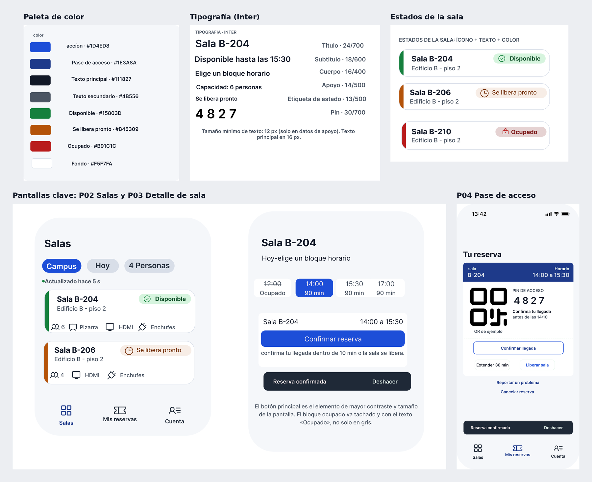

# 7. Diseño Visual y Emocional

Este apartado justifica las decisiones visuales y emocionales de la **PWA Mobile-First con Tablero Visual** para las pantallas definidas en el apartado 6. El criterio central es que, en una hora punta y con una mano, el estudiante entienda en segundos qué sala puede usar, sienta que la reserva está asegurada y mantenga el control en todo momento.

La evidencia visual de este apartado es el **tablero de estilo** (`prototipo/tablero_de_estilo.png`). Allí aparecen la paleta, la tipografía, los estados de la sala y los componentes de las pantallas P02 (Salas), P03 (Detalle de sala) y P04 (Pase de acceso). El prototipo navegable del apartado 8 los aplica a las pantallas completas.

*Tablero de estilo del prototipo: paleta, tipografía, estados de la sala y pantallas clave.*

## 7.1 Objetivos emocionales

El contexto de uso (1.3) es de prisa, ruido y coordinación con compañeros. Por eso el equipo definió qué debe **sentir** el usuario, pues la emoción influye en cómo se percibe la usabilidad (Rogers, Sharp y Preece, 2023). Se organizó según los tres niveles del diseño emocional de Norman (2004).

| Nivel | Qué debe sentir el estudiante | Decisión de diseño |
| :--- | :--- | :--- |
| **Visceral** (primera impresión) | Orden y calma, no saturación. | Fondo gris muy claro, tarjetas blancas y un solo color de acción. El color intenso se reserva para estados y botones, de modo que lo importante se distingue a primera vista. |
| **Conductual** (al usar) | Rapidez y control. | Botón principal grande, respuesta inmediata a cada toque, deshacer disponible y flujo de 3 toques (6.5). |
| **Reflexivo** (al recordar) | «Esto funciona y me ahorra tiempo.» | Confirmación clara con pase digital, avisos puntuales y una sala que realmente está disponible al llegar. |

Los tres sentimientos que guían las decisiones son **confianza** (la información es real y la reserva está asegurada), **control** (puedo corregir y decidir) y **tranquilidad** (no me exige más de lo necesario).

## 7.2 Decisiones por criterio

| Criterio | Decisión aplicada | Dónde se ve | Requisito |
| :--- | :--- | :--- | :--- |
| **Jerarquía visual** | En cada pantalla hay un solo elemento dominante, de mayor tamaño y contraste, y el resto se ordena en dos niveles de apoyo (ver 7.5). | P02, P03 y P04 en el tablero. | RNF01, RNF03 |
| **Claridad** | Una tarea por pantalla, mucho espacio entre elementos, íconos que acompañan al texto y etiquetas del sistema definido en 6.3. | Fichas, barra de resumen. | RNF02 |
| **Legibilidad** | Tipografía sans-serif de 16 px en el cuerpo, escala de seis niveles y contrastes sobre 4,5 : 1 en todo el texto (ver 7.3 y 7.4). | Tabla de color y tipografía. | RNF02 |
| **Retroalimentación** | Cada acción recibe respuesta visual y de texto en menos de un segundo, con el mismo verbo del botón (ver 7.6). | Toast *Reserva confirmada · Deshacer*. | RNF04 |
| **Confianza** | Información con sello de actualización, reglas visibles antes de reservar y un pase de acceso que se parece a un documento oficial (ver 7.7). | «Actualizado hace 5 s», pase de acceso. | RF01, RF03 |
| **Sensación de control** | Deshacer, cancelar, liberar y extender siempre disponibles, y acciones poco frecuentes sin protagonismo para evitar toques accidentales (ver 7.7). | Botón de texto *Liberar sala*. | RNF04, RF04 |

## 7.3 Color

La paleta es corta a propósito: un color de acción, un color de pase, dos neutros de texto y tres colores semánticos. Los contrastes se calcularon con la fórmula de WCAG 2.2 y todos cumplen el nivel AA (4,5 : 1 para texto y 3 : 1 para elementos gráficos).

| Rol | Color | Uso | Contraste |
| :--- | :--- | :--- | :--- |
| **Acción** | `#1D4ED8` | Botón principal, filtro activo, bloque seleccionado, enlaces. | Blanco sobre este color: **6,7 : 1** |
| **Pase de acceso** | `#1E3A8A` | Encabezado del pase digital. | Blanco sobre este color: **10,4 : 1** |
| **Texto principal** | `#111827` | Títulos y cuerpo. | Sobre blanco: **17,7 : 1** |
| **Texto secundario** | `#4B5563` | Datos de apoyo (edificio, capacidad). | Sobre blanco: **7,6 : 1** |
| **Disponible** | `#15803D` (franja), `#14532D` sobre `#E7F6EC` (etiqueta) | Estado de la sala. | Franja: 5,0 : 1. Etiqueta: **8,2 : 1** |
| **Se libera pronto** | `#B45309` (franja), `#78350F` sobre `#FEF3C7` (etiqueta) | Estado de la sala. | Franja: 5,0 : 1. Etiqueta: **8,2 : 1** |
| **Ocupada** | `#B91C1C` (franja), `#7F1D1D` sobre `#FDECEC` (etiqueta) | Estado de la sala. | Franja: 6,5 : 1. Etiqueta: **8,8 : 1** |
| **Fondo y tarjetas** | `#F5F7FA` y `#FFFFFF` | Fondo de la app y de las tarjetas. | Texto principal sobre el fondo: 16,5 : 1 |

**Reglas de uso del color**

1. El **verde, el ámbar y el rojo** se usan solo para el estado de las salas. Ningún botón usa esos colores, de modo que el significado no se confunde. Por eso *Liberar sala* usa el color de acción y no el rojo.
2. El **color de acción** es el único color saturado fuera de los estados. Donde aparece, el usuario puede tocar.
3. El color **nunca** es el único portador del significado (RNF02). Cada estado combina color, ícono y texto (ver 7.4).
4. El tinte de fondo de las etiquetas de estado es suave y el texto es oscuro, para que la etiqueta sea legible incluso con brillo bajo o sol en el patio.

## 7.4 Tipografía y estados

**Tipografía.** Se usa **Inter**, una sans-serif diseñada para pantallas, con alternativas del sistema (Roboto o Arial) si no está disponible. La escala tiene seis niveles, para que la jerarquía se perciba por tamaño y peso y no por decoración.

| Nivel | Tamaño y peso | Uso |
| :--- | :--- | :--- |
| Título | 24 px, 700 | Nombre de la sala, título de pantalla. |
| Subtítulo | 18 px, 600 | Disponibilidad, horario destacado. |
| Cuerpo | 16 px, 400 | Instrucciones y descripciones. |
| Apoyo | 14 px, 500 | Edificio, capacidad, notas. |
| Etiqueta | 13 px, 600 | Estado de la sala, botones de bloque. |
| PIN | 30 px, 700 | Código de acceso, con espaciado amplio. |

Las horas y el PIN usan **cifras tabulares**, para que no se desplacen al cambiar. El texto más pequeño (12 px) se reserva a datos secundarios.

**Estados de la sala.** Cada estado combina tres señales, por lo que se distingue incluso para quien no percibe bien los colores:

| Estado | Color | Ícono | Texto |
| :--- | :--- | :--- | :--- |
| Disponible | Verde | Check dentro de un círculo | «Disponible» |
| Se libera pronto | Ámbar | Reloj | «Se libera pronto» |
| Ocupada | Rojo | Candado | «Ocupada» |

La ficha ocupada atenúa su título para que las salas disponibles destaquen primero. El bloque horario ocupado va **tachado y con el texto «Ocupado»**, no solo en gris.

## 7.5 Jerarquía visual por pantalla

| Pantalla | Primer nivel (lo que se ve primero) | Segundo nivel | Tercer nivel |
| :--- | :--- | :--- | :--- |
| **P02 Salas** | Fichas con franja de color y etiqueta de estado. | Filtros activos (campus, fecha, personas) y sello de actualización. | Equipamiento y barra de navegación. |
| **P03 Detalle de sala** | Línea de tiempo con el bloque seleccionado y el botón *Confirmar reserva*. | Resumen de sala y horario, y regla de llegada. | Fotos y equipamiento. |
| **P04 Pase de acceso** | Sala y horario en el encabezado azul. | QR y PIN, junto con el plazo para confirmar llegada. | *Confirmar llegada*, *Extender 30 min* y *Liberar sala*. |

En P04 solo la acción principal del momento (*Confirmar llegada*) lleva borde de color. *Extender 30 min* tiene borde neutro y *Liberar sala* es un botón de texto sin relleno. Así, la acción más probable es la más visible y la menos frecuente no se toca por accidente.

**Tamaño de las áreas táctiles.** Los botones principales miden 52 px de alto y los secundarios 48 px, y los filtros y bloques horarios 44 px o más, con separación de 8 px. Todos superan el mínimo de 24 px de WCAG 2.2 (criterio 2.5.8) y favorecen el uso con una mano (RNF03).

## 7.6 Retroalimentación

Cada acción recibe una respuesta inmediata, como exige la heurística de visibilidad del estado del sistema (Nielsen, 1994). El mensaje repite el verbo del botón (regla 2 de 6.3), de modo que el usuario reconoce que lo que pidió es lo que ocurrió.

| Acción del usuario | Respuesta visual | Mensaje | Tiempo |
| :--- | :--- | :--- | :--- |
| Cambiar un filtro | El tablero se actualiza y el chip queda en color de acción. | (sin mensaje, el cambio se ve) | Inmediato |
| Tocar un bloque horario | El bloque se pinta de azul y aparece la barra de resumen. | (sin mensaje) | Inmediato |
| **Confirmar reserva** | Abre el pase de acceso con QR y PIN. | «Reserva confirmada» + *Deshacer* | Menos de 1 s |
| **Confirmar llegada** | El pase cambia a estado *En uso*. | «Llegada confirmada. La sala es tuya hasta las 15:30.» | Menos de 1 s |
| **Liberar sala** | La reserva sale de *Mis reservas* y el tablero se actualiza. | «Sala liberada» + *Deshacer* | Menos de 1 s |
| **Cancelar reserva** | La sala vuelve a *Disponible*. | «Reserva cancelada» + *Deshacer* | Menos de 1 s |
| Bloque tomado por otra persona | Se marca como *Ocupado* y se propone el siguiente. | «Ese bloque se acaba de ocupar. El siguiente libre es a las 15:30.» | Inmediato |
| Sin salas disponibles | Se ofrece ajustar filtros y se destacan las salas *Se libera pronto*. | «No hay salas libres ahora. Prueba con otro horario o mira las que se liberan pronto.» | Inmediato |
| Sin conexión | Mensaje fijo en la parte superior. | «Sin conexión. Tu reserva no se ha enviado; reintenta cuando tengas señal.» | Inmediato |

**Tono de los mensajes.** Cercano y breve, con tuteo, sin disculpas excesivas ni mayúsculas. Los errores explican qué pasó y qué hacer. Los avisos solo se envían cuando exigen una decisión: 10 minutos antes del bloque (confirmar llegada) y 10 minutos antes del término (extender o liberar).

**Movimiento.** Las transiciones duran entre 150 y 250 ms y sirven para mostrar de dónde viene un elemento (por ejemplo, la barra de resumen que sube desde abajo), no para decorar. Si el dispositivo tiene activada la opción «reducir movimiento», se reemplazan por cambios directos.

## 7.7 Confianza y sensación de control

**Confianza**

* **Información real y fechada.** El tablero muestra «Actualizado hace 5 s». Si la conexión falla, lo informa en lugar de mostrar datos antiguos como vigentes.
* **Reglas a la vista antes de decidir.** Bajo el botón de confirmación se lee «Confirma tu llegada dentro de 10 min o la sala se libera». El usuario sabe la condición *antes* de reservar y no después de perder la sala.
* **Pase con aspecto de documento.** El encabezado azul, el borde perforado y el PIN grande comunican que es un comprobante válido (metáfora del apartado 4) y se leen bien desde la puerta de la sala.
* **Datos mínimos.** Solo se pide el correo institucional. No hay formularios largos (problema descrito en 1.1).

**Sensación de control**

* **Deshacer visible** durante unos segundos tras reservar, cancelar o liberar (RNF04).
* **Salida siempre disponible.** El usuario puede cancelar, extender o liberar desde el pase, sin buscar en menús.
* **Sin toques accidentales con consecuencias.** Las acciones menos frecuentes no tienen protagonismo visual, y las que afectan a otros estudiantes (cancelar o liberar) ofrecen *Deshacer*.
* **Avisos que se pueden gobernar.** Desde *Cuenta* el usuario decide qué notificaciones recibe.

## 7.8 Verificación de accesibilidad

| Criterio | Resultado | Fuente |
| :--- | :--- | :--- |
| Contraste de texto (mínimo 4,5 : 1) | Cumple: el menor valor es 5,0 : 1 (franja de estado) y el texto mínimo es 6,7 : 1. | Cálculo del equipo con la fórmula de WCAG 1.4.3 |
| Contraste de elementos gráficos (mínimo 3 : 1) | Cumple: franjas de estado, íconos y bordes de acción desde 5,0 : 1. | WCAG 1.4.11 |
| El color no es el único medio | Cumple: cada estado tiene ícono y texto. | RNF02 |
| Tamaño de las áreas táctiles | Cumple: 44 px o más (mínimo WCAG 2.2: 24 px). | WCAG 2.5.8 |
| Texto legible sin zoom | Cumple: 16 px en el cuerpo. | Decisión del equipo |
| Movimiento reducido | Contemplado en 7.6. | Decisión del equipo |

**Fuera del alcance de este trabajo:** el modo oscuro y la prueba con lector de pantalla. Se proponen como mejoras futuras.

## Referencias

* Nielsen, J. (1994). *10 Usability Heuristics for User Interface Design*. Nielsen Norman Group.
* Norman, D. A. (2004). *Emotional Design: Why We Love (or Hate) Everyday Things*. Basic Books.
* Rogers, Y., Sharp, H. y Preece, J. (2023). *Interaction Design: Beyond Human-Computer Interaction* (6.ª ed.). Wiley.
* W3C. (2023). *Web Content Accessibility Guidelines (WCAG) 2.2*. World Wide Web Consortium.
