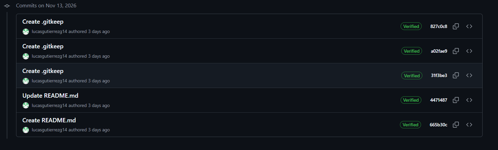
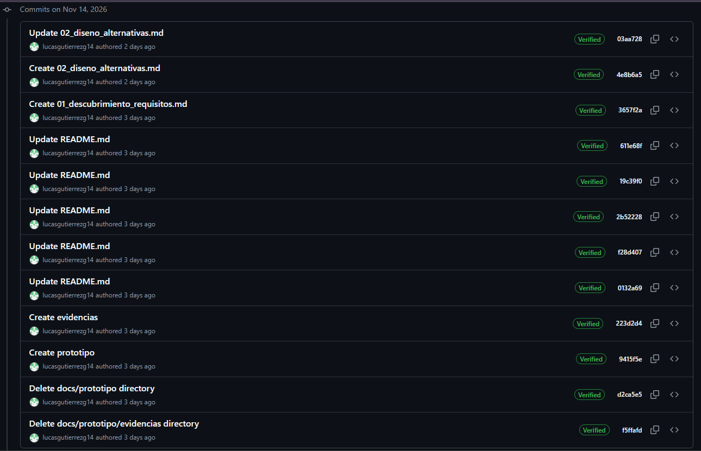
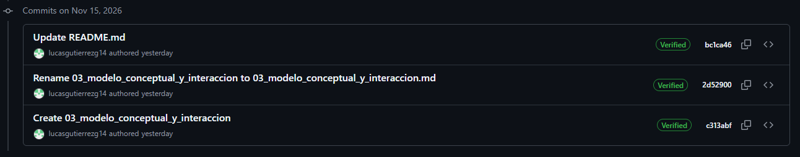
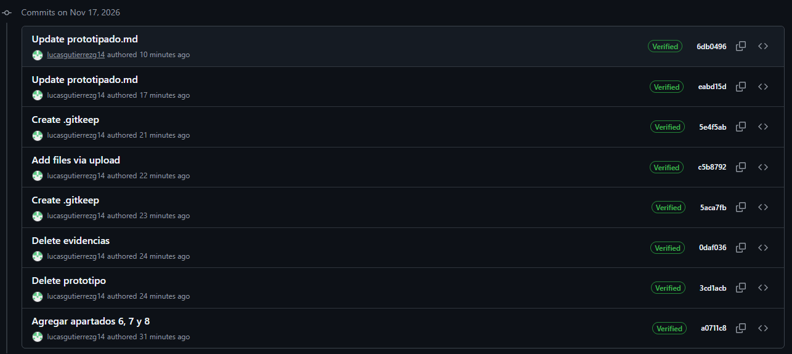

# 9. Uso de GitHub

## 9.1 Repositorio del proyecto

**URL del repositorio:** [https://github.com/lucasgutierrezg14/ihc-unidad2-Grupo10](https://github.com/lucasgutierrezg14/ihc-unidad2-Grupo10)

El repositorio es público y utiliza una única rama principal (`main`). Se usa para el control de versiones, el registro de avances y el almacenamiento de las evidencias del proceso, según lo acordado por el equipo.

| Carpeta o archivo | Contenido |
| :--- | :--- |
| `README.md` | Datos del grupo, acuerdos del equipo, roles y estructura del repositorio. |
| `docs/` | Documentos de cada apartado del informe técnico. |
| `prototipo/` | Imagen del flujo de pantallas del prototipo. El prototipo navegable está en Figma. |
| `evidencias/` | Capturas del historial de commits como evidencia del proceso. |

## 9.2 Acuerdos del equipo

* **Herramientas:** GitHub (control de versiones y evidencias), Figma (wireframes, arquitectura de información y prototipo) y Google Docs o Word (redacción colaborativa del informe final).
* **Frecuencia de avances:** cada integrante se comprometió a subir avances, borradores o evidencias al repositorio al menos dos veces por semana, detallando el cambio realizado en el mensaje de cada *commit*.
* **Roles:**

| Integrante | Responsabilidad acordada | Apartados |
| :--- | :--- | :---: |
| Lucas Gutierrez Galmez | Gestión y orden del repositorio, consolidación del informe, diseño visual y emocional, y uso de GitHub | 7 y 9 |
| Esteban Sandoval | Descubrimiento de requisitos y diseño de alternativas | 1 y 2 |
| Felipe Marin | Modelo conceptual, metáfora de interfaz y tipos de interacción | 3, 4 y 5 |
| Todo el equipo | Arquitectura de información, flujo de usuario y prototipo navegable | 6 y 8 |

## 9.3 Organización de los documentos

Cada documento de `docs/` lleva como prefijo el número del primer apartado que contiene, y el nombre indica su tema.

| Archivo | Apartado |
| :--- | :--- |
| `01_descubrimiento_requisitos.md` | 1. Descubrimiento de requisitos |
| `02_diseno_alternativas.md` | 2. Diseño de alternativas |
| `03_modelo_conceptual_y_interaccion.md` | 3. Modelo conceptual, 4. Metáfora de interfaz y 5. Tipos de interacción |
| `06_arquitectura_informacion_y_flujo.md` | 6. Arquitectura de información y flujo de usuario |
| `07_diseno_visual_y_emocional.md` | 7. Diseño visual y emocional |
| `08_prototipado.md` | 8. Prototipado |
| `09_uso_github_y_referencias.md` | 9. Uso de GitHub y referencias |

Convenciones de trabajo:

* Cada cambio se registra en un *commit* con un mensaje que explica qué se modificó.
* Los diagramas se escriben en Mermaid dentro de los documentos, de modo que GitHub los muestra directamente, y se exportan como imagen para el informe final.
* Las evidencias se guardan en `evidencias/` y el prototipo en `prototipo/`, con nombres descriptivos.

## 9.4 Registro de avances

Resumen de los *commits* realizados hasta el 17 de noviembre de 2026:

| Fecha | Commits | Avance registrado |
| :--- | :---: | :--- |
| 13 de noviembre | 5 | Creación del repositorio y del README con los datos del grupo, los acuerdos del equipo, los roles y la estructura de carpetas. |
| 14 de noviembre | 12 | Ajustes del README y de la estructura de carpetas; documentos de los apartados 1 y 2. |
| 15 de noviembre | 3 | Documento de los apartados 3, 4 y 5 y ajuste del README. |
| 17 de noviembre | 10 | Documentos de los apartados 6, 7 y 8; reorganización de las carpetas `prototipo/` y `evidencias/`; imagen del prototipo y capturas del historial. |

Hasta el 16 de noviembre, los cambios se subieron desde la cuenta del integrante encargado del repositorio (Lucas Gutierrez Galmez), a partir de los borradores que los demás integrantes le enviaban. Desde el 17 de noviembre, los integrantes con acceso al repositorio registran sus cambios desde su propia cuenta. El historial completo y actualizado se puede consultar en [https://github.com/lucasgutierrezg14/ihc-unidad2-Grupo10/commits/main](https://github.com/lucasgutierrezg14/ihc-unidad2-Grupo10/commits/main).

## 9.5 Evidencias del proceso

**Historial de commits** (capturas tomadas el 17 de noviembre de 2026):

**Prototipo:** el prototipo navegable está disponible en [Figma (archivo IHC)](https://www.figma.com/design/Pu9Fsc8kWGA1VjNskBMF9d/IHC?node-id=0-1) y su descripción completa se encuentra en `08_prototipado.md`.

---

## Referencias

Gabriel-Petit, P. (2025). *Designing information architecture: A practical guide to structuring digital content for findability and easy navigability*. Packt Publishing.

Nielsen, J. (1994). *10 usability heuristics for user interface design*. Nielsen Norman Group.

Norman, D. A. (2004). *Emotional design: Why we love (or hate) everyday things*. Basic Books.

Preece, J., Rogers, Y. & Sharp, H. (2019). *Interaction design: Beyond human-computer interaction* (5.ª ed.). Wiley.

Rogers, Y., Sharp, H. & Preece, J. (2023). *Interaction design: Beyond human-computer interaction* (6.ª ed.). Wiley.

Rosenfeld, L., Morville, P. & Arango, J. (2015). *Information architecture: For the web and beyond* (4.ª ed.). O'Reilly Media.

Stimac, S. (2023). *Design for developers*. Manning Publications.

World Wide Web Consortium (W3C). (2023). *Web content accessibility guidelines (WCAG) 2.2*. W3C.
