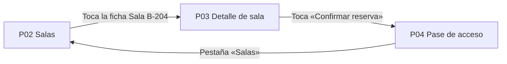

# 8. Prototipado

Este apartado presenta la representación de la solución seleccionada (la **PWA Mobile-First con Tablero Visual**, apartado 2) mediante un prototipo navegable construido en Figma. El prototipo permite recorrer la tarea principal definida en 1.4, *consultar la disponibilidad de una sala y reservarla*, tal como se diseñó en el flujo del apartado 6.5.1 y con el estilo visual del apartado 7.

**Prototipo navegable en Figma:** [https://www.figma.com/design/Pu9Fsc8kWGA1VjNskBMF9d/IHC?node-id=0-1&t=XSpb5wLoN10sxNSU-1]

## 8.1 Tipo de prototipo y herramienta

| Aspecto | Decisión | Justificación |
| :--- | :--- | :--- |
| **Fidelidad** | **Media-alta.** Usa la paleta, la tipografía, los componentes y los textos definidos en el apartado 7, pero con datos simulados y sin lógica real. | El objetivo es evaluar si el estudiante entiende el tablero, distingue los estados y completa la reserva. Para eso se necesitan jerarquía, color y etiquetas reales. Un boceto de baja fidelidad no permite juzgar esas decisiones (Preece, Rogers y Sharp, 2019). |
| **Herramienta** | Figma, con Inter como tipografía. | Permite trabajar en equipo sobre un mismo archivo, reutilizar estilos y componentes, y conectar pantallas para recorrerlas como una aplicación. |
| **Dispositivo** | Teléfono, marco de 390 × 844 px. | Coincide con la decisión *mobile-first* (RNF03) y con el contexto de uso: de pie, con una mano. |
| **Interacción simulada** | Toques sobre elementos conectados, con transición animada de 200 ms. | Reproduce el flujo de tres pasos del apartado 6.5.1 (RNF01). |

## 8.2 Alcance del prototipo

El prototipo se concentra en las tres pantallas que sostienen la tarea principal del apartado 6.5.1: P02 Salas, P03 Detalle de sala y P04 Pase de acceso. Las demás secciones del mapa de contenidos (6.2.1) quedan descritas en el apartado 6 y se construirán en una siguiente iteración.

| Pantalla (según el mapa de contenidos, 6.2.1) | ID | En el prototipo | Qué muestra |
| :--- | :--- | :--- | :--- |
| Salas | P02 | Sí | Filtros, indicador de actualización y fichas con el estado de cada sala. |
| Detalle de sala | P03 | Sí | Bloques horarios, resumen de la reserva y botón *Confirmar reserva*. |
| Pase de acceso | P04 | Sí | QR de ejemplo, PIN y acciones: confirmar llegada, extender, liberar, reportar y cancelar. |
| Inicio de sesión | n/a | No (por construir) | Descrita en 6.5.1. |
| Mis reservas (reserva vigente) | n/a | No (por construir) | Descrita en 6.2.1. |
| Cuenta (perfil y notificaciones) | n/a | No (por construir) | Descrita en 6.2.1. |

## 8.3 Flujo navegable

El recorrido que se puede probar en el prototipo es el flujo principal del apartado 6.5.1.

| Desde | Elemento que se toca | Hacia | Animación |
| :--- | :--- | :--- | :--- |
| P02 Salas | Ficha «Sala B-204» (estado Disponible) | P03 Detalle de sala | Smart animate, 200 ms |
| P03 Detalle de sala | Botón «Confirmar reserva» | P04 Pase de acceso | Smart animate, 200 ms |
| P04 Pase de acceso | Pestaña «Salas» de la barra de navegación inferior | P02 Salas | Smart animate, 200 ms |

## 8.4 Pantallas del prototipo

*Figura 1. Flujo de pantallas del prototipo: P02 Salas, P03 Detalle de sala y P04 Pase de acceso.*

### P02 · Salas

* **Qué resuelve:** responde a la pregunta «¿qué sala puedo usar ahora?» (RF01) con la lista de salas y su estado actual.
* **Elementos clave:** filtros visibles (campus, fecha y personas); indicador de actualización de datos; fichas con franja de color, ícono y texto de estado (*Disponible*, *Se libera pronto*, *Ocupada*); barra de navegación inferior con *Salas*, *Mis reservas* y *Cuenta*.
* **Decisiones visuales aplicadas:** las salas disponibles tienen más contraste que la ocupada, que atenúa su título (7.4).

### P03 · Detalle de sala

* **Qué resuelve:** permite elegir el bloque horario y confirmar sin cambiar de pantalla (RF02, RNF01).
* **Elementos clave:** botón de retorno «‹ Salas»; bloques horarios con el bloque seleccionado en color de acción y el bloque ocupado distinguible; resumen de la reserva con el botón *Confirmar reserva*; regla de llegada visible antes de reservar.
* **Decisiones visuales aplicadas:** el botón de confirmación es el elemento de mayor contraste y tamaño (jerarquía, 7.5).

### P04 · Pase de acceso

* **Qué resuelve:** entrega el comprobante de la reserva y concentra las acciones durante el uso (RF03, RF04), como se definió en 6.2.1.
* **Elementos clave:** encabezado azul con sala y horario; QR y PIN de 4 dígitos; plazo para confirmar llegada; acciones *Confirmar llegada*, *Extender 30 min*, *Liberar sala*, *Reportar un problema* y *Cancelar reserva*; mensaje «Reserva confirmada» con *Deshacer*.
* **Decisiones visuales aplicadas:** solo la acción principal del momento tiene borde de color. Las acciones menos frecuentes tienen menor protagonismo (7.5).

## 8.5 Trazabilidad con los requisitos

| Requisito | Dónde se ve en el prototipo | Estado |
| :--- | :--- | :--- |
| **RF01** Consulta en tiempo real | P02: fichas con estado visible, filtros e indicador de actualización de datos. | Representado |
| **RF02** Selección de bloque horario | P03: bloques horarios con el bloque seleccionado y el ocupado identificado. | Representado |
| **RF03** Confirmación y código de acceso | Botón de P03 y pase de acceso de P04 con QR y PIN. | Representado |
| **RF04** Check-in y liberación anticipada | Acciones *Confirmar llegada* y *Liberar sala* en P04. | Representado (sin lógica) |
| **RF05** Gestión de reservas activas | Acciones *Extender 30 min* y *Cancelar reserva* en P04. La sección *Mis reservas* queda pendiente. | Parcial |
| **RNF01** Eficiencia de interacción | Recorrido P02 → P03 → P04 en tres toques. | Verificable en el prototipo |
| **RNF02** Claridad y baja carga cognitiva | Estados con color, ícono y texto; una acción principal por pantalla. | Representado |
| **RNF03** Diseño adaptable (mobile-first) | Marco de teléfono, barra de navegación inferior y acciones principales en la zona inferior de la pantalla. | Representado |
| **RNF04** Retroalimentación inmediata | Mensaje «Reserva confirmada» con *Deshacer* en P04. El mensaje de error por bloque ocupado no está simulado. | Parcial |

## 8.6 Limitaciones del prototipo

* **Datos simulados.** Las salas, los horarios, el PIN y el indicador de actualización son ejemplos. El QR es ilustrativo y no se puede escanear.
* **Sin conexión a un sistema real.** No hay disponibilidad en tiempo real ni confirmación efectiva de reservas.
* **Una sola ruta navegable.** Está conectado el flujo principal. El ciclo de uso (6.5.2: llegada, extensión y liberación) y los caminos alternativos (sin salas disponibles, bloque tomado por otra persona, sin conexión) se muestran como botones o quedan descritos en el apartado 6, pero no tienen pantallas posteriores.
* **Pantallas pendientes.** Inicio de sesión, Mis reservas y Cuenta no están construidas en esta versión.

Estas limitaciones son habituales en un prototipo de este nivel: sirve para probar la comprensión y el flujo, no el funcionamiento técnico.

## 8.7 Plan de validación con usuarios

El prototipo se usará para comprobar el flujo del apartado 6.5.1 y los puntos que ese apartado deja para la evaluación con usuarios: el tiempo máximo de 45 segundos (RNF01) y la comprensión de las etiquetas y de la regla de llegada de 10 minutos (6.5.2). Participarán **3 a 5 compañeros** que cumplan el perfil del usuario principal (estudiantes que reservan salas de estudio).

**Tarea que se les pedirá:** «Reserva una sala disponible para las 14:00. Cuando termines, dime qué entendiste que debes hacer al llegar.»

**Qué se mide**

| Medida | Cómo se obtiene | Meta |
| :--- | :--- | :--- |
| Toques hasta reservar | Observación directa. | 3 (RNF01) |
| Tiempo hasta reservar | Cronómetro desde que ven P02 hasta que ven P04. | 45 s o menos (RNF01) |
| Errores | Toques en elementos equivocados. | 0 a 1 |
| Comprensión de estados | Preguntar qué significa cada color o etiqueta de las fichas. | Los 3 estados reconocidos |
| Comprensión de la regla de llegada | Preguntar qué deben hacer al llegar. | Mencionan los 10 minutos |

**Resultados** *(se completan después de las pruebas; las capturas y notas se guardan en `/evidencias`)*

## Referencias

* Preece, J., Rogers, Y. y Sharp, H. (2019). *Interaction Design: Beyond Human-Computer Interaction* (5.ª ed.). Wiley.
